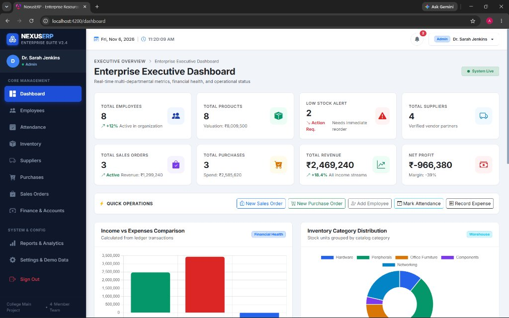
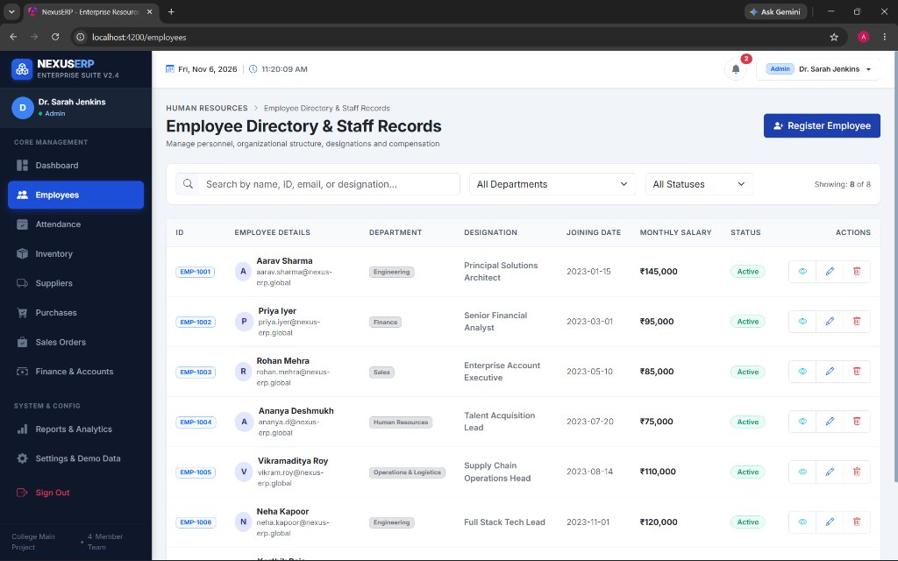
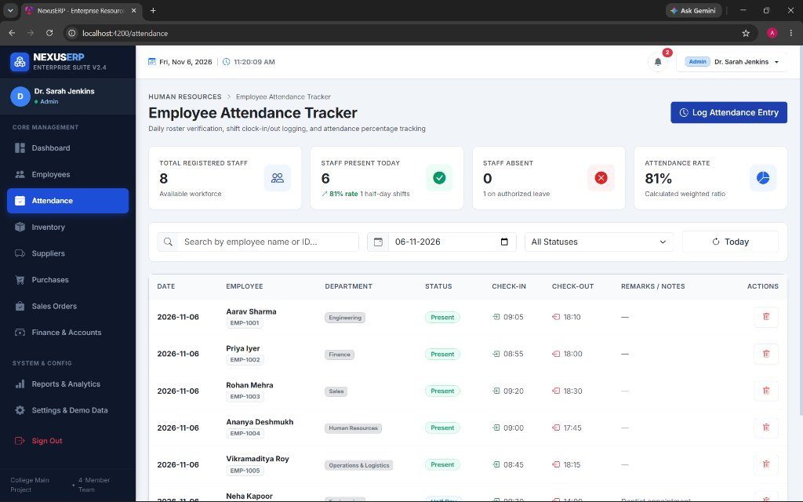
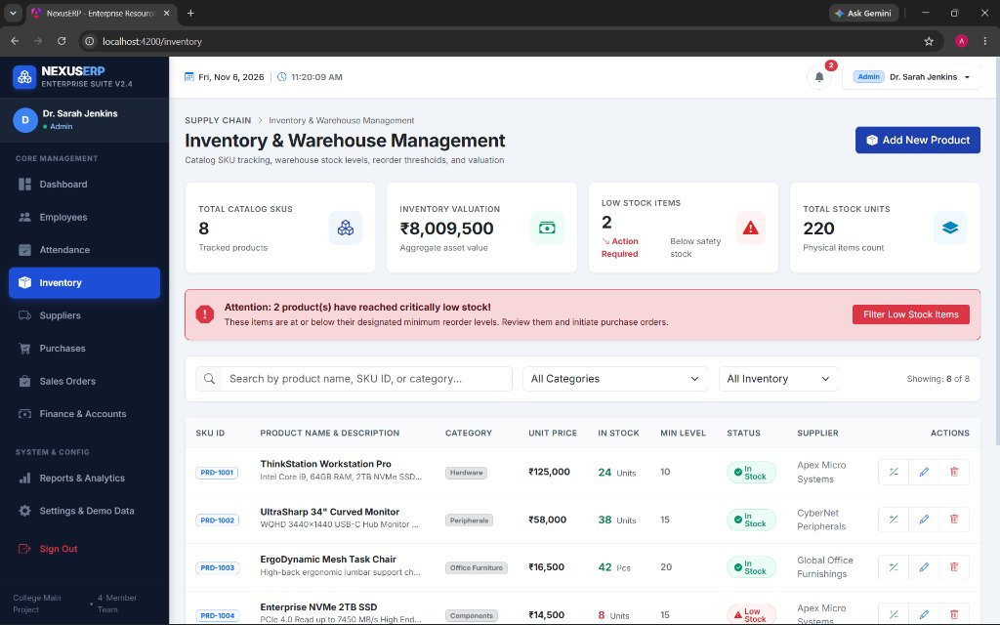
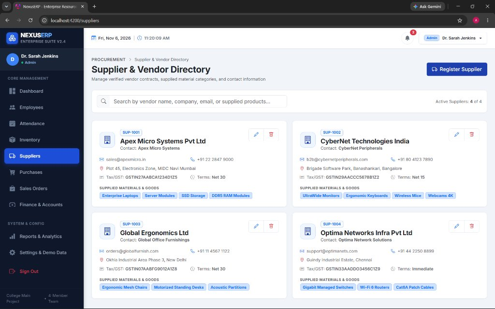
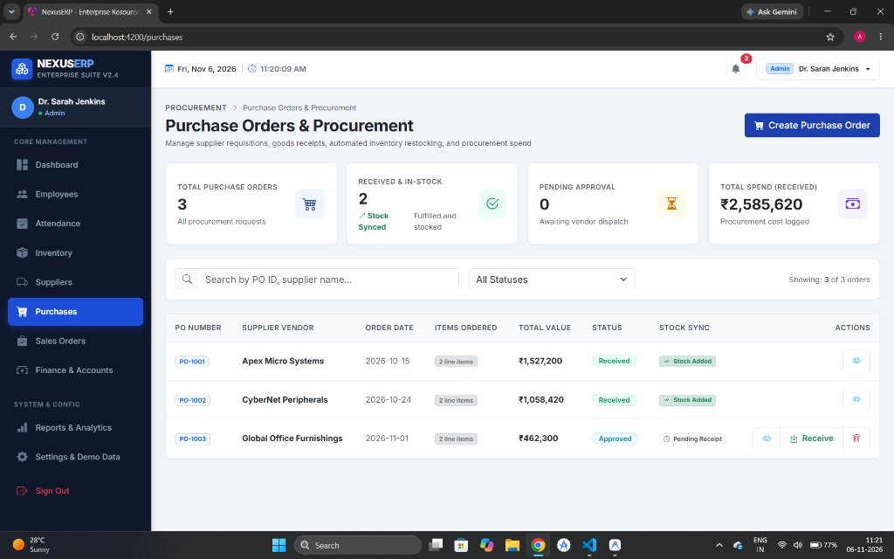
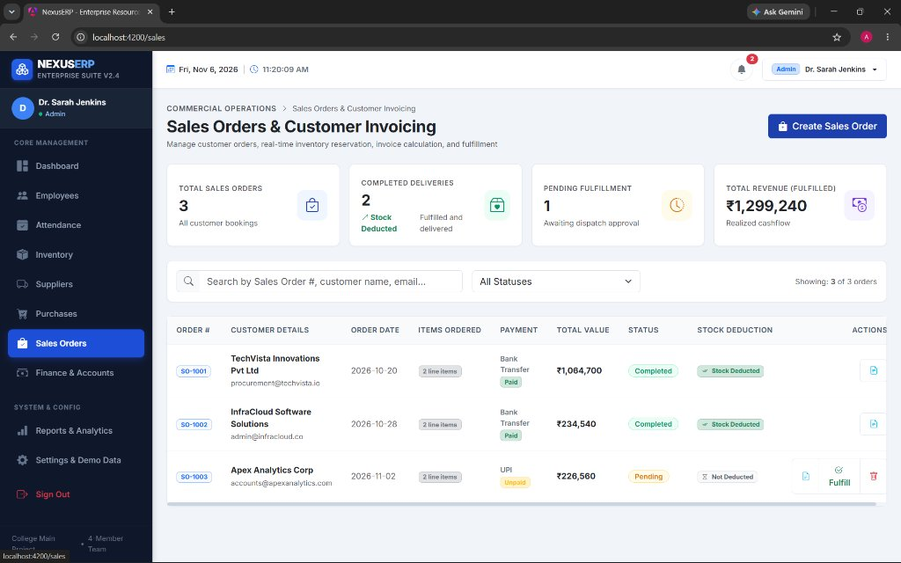
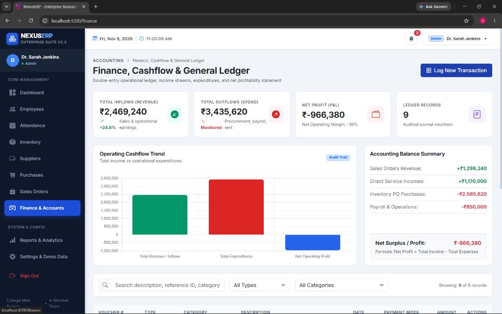
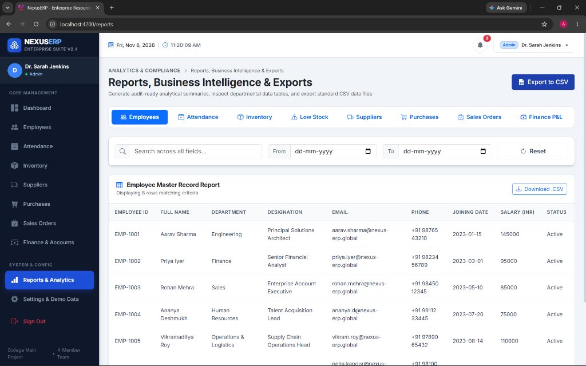

<div align="center">

# Sanjivani University
### Department Of Computer Science And Engineering

---

## HCL Tech MAIN PROJECT REPORT
### On
# ENTERPRISE RESOURCE PLANNING (ERP) SYSTEM
### ( NexusERP )

<p align="center">
  <b>A Modern, Responsive Enterprise Resource Planning Platform built with Angular Standalone Architecture</b>
</p>

[](https://angular.dev/)
[](https://www.typescriptlang.org/)
[](https://getbootstrap.com/)
[]()

</div>

---

### Project Metadata

- **Project Trainer:** Franklin Sir
- **Academic Year:** 2026–2027
- **Submission Date:** 06 November 2026
- **Git Repo Link:** [https://github.com/Ayush-D27/angular-erp-system](https://github.com/Ayush-D27/angular-erp-system)

---

## 👥 Submitted By & Individual Contribution

| Sr. No. | Team Member Name | PRN | Individual Contribution |
| :---: | :--- | :---: | :--- |
| **1** | **Ayush Deore** | **2124UCEM1091** | Core Architecture, Routing and Dashboard |
| **2** | **Vedant Aadmane** | **2124UCEM1090** | Employee Management and Attendance Tracking |
| **3** | **Hrushil Sonawane** | **2124UCEM1092** | Inventory Management and Supplier Procurement |
| **4** | **Yuvraj Gaikwad** | **2124UCEM1088** | Sales Orders, Finance Ledger and Business Reports |

---

## 📖 Executive Summary

**NexusERP** is a full-featured, modular Enterprise Resource Planning (ERP) web application developed using Angular's modern standalone component architecture. Designed to solve data fragmentation and operational friction in mid-market enterprises, NexusERP unifies human resources, workforce attendance, warehouse inventory, vendor procurement, commercial sales order fulfillment, double-entry financial ledger accounting, and cross-departmental business intelligence into a cohesive, single-page application (SPA).

The system implements strict business validation logic, including duplicate attendance entry prevention, warehouse stock reservation checks, single-execution inventory deduction/restocking, automated GST calculations, and one-click RFC-4180 compliant CSV analytical exports.

---

## 🚀 Key Functional Modules

### 1. Executive Dashboard (`/dashboard`)
- **8 Real-Time KPI Cards:** Total Employees, Total Products, Total Suppliers, Total Sales Orders, Total Purchases, Total Inflow Revenue, Net Operating Profit, and Critical Low-Stock Alerts.
- **4 Dynamic HTML5 Canvas Charts:**
  - *Income vs Expense Comparison* (Operating profitability visualization).
  - *Inventory Category Distribution* (Doughnut breakdown by category).
  - *Sales Orders Breakdown* (Fulfillment status distribution).
  - *Procurement Spend Analysis* (Vendor expenditure tracking).
- **Critical Action Feed:** Direct quick-action buttons for creating sales orders, purchase orders, logging attendance, registering employees, and recording ledger transactions.

### 2. Employee Management (`/employees`)
- **Automated Sequential ID Allocation:** Generates unique IDs starting at `EMP-1001`.
- **Complete CRUD Operations:** Create, read, update, and delete employee records with immediate table synchronization.
- **Advanced Filtering & Search:** Real-time multi-attribute search across employee names, designations, and emails, coupled with department dropdown filtering (Engineering, Finance, Sales, HR, Logistics).

### 3. Attendance Tracking (`/attendance`)
- **Daily Shift Logging:** Tracks staff status across *Present*, *Absent*, *Half Day*, and *On Leave* with shift timestamps.
- **Duplicate Attendance Prevention:** Enforces strict validation preventing multiple attendance records from being created for the same employee on the same calendar date.
- **Computed Workforce Metrics:** Live computation of workforce presence percentage, total absent personnel, and active shift counts.

### 4. Inventory & Warehouse Management (`/inventory`)
- **Automated SKU Generator:** Assigns sequential product codes starting from `PRD-1001`.
- **Threshold Safety Monitoring:** Flags products when physical stock falls below safety reorder levels, triggering visual warning alerts and header notification badges.
- **Manual Stock Adjustments:** Audit-logged stock increment and decrement controls with automated valuation adjustments.

### 5. Supplier & Vendor Directory (`/suppliers`)
- **Comprehensive Vendor Profiles:** Stores company details, primary points of contact, verified GSTIN/tax identification numbers, and credit terms (e.g., Net 15, Net 30).
- **Supplied Category Tagging:** Maps suppliers to material categories (Enterprise Laptops, SSD Storage, Ergonomic Furniture, Network Switches).

### 6. Purchase Orders & Procurement (`/purchases`)
- **Interactive Purchase Order Builder:** Multi-line item picker, automated subtotal calculations, dynamic 18% GST computation, and freight handling.
- **Goods Receipt & Stock Restocking Integration:** Marking a Purchase Order as `Received` automatically updates warehouse inventory stock units and registers an expense voucher in the financial ledger.
- **Idempotent Stock Restock:** Guards guarantee that inventory stock is incremented exactly once per order.

### 7. Sales Orders & Commercial Invoicing (`/sales`)
- **Warehouse Availability Pre-Check:** Strictly blocks the generation of sales orders if requested quantities exceed current warehouse stock.
- **Fulfillment & Stock Deduction:** Marking a Sales Order as `Completed` automatically deducts product quantities from inventory and logs sales revenue to the accounting ledger.
- **Commercial Tax Invoice:** Generates a printable, audit-ready tax invoice modal featuring customer details, itemized line items, GST breakdown, and payment status.

### 8. Finance, Cashflow & General Ledger (`/finance`)
- **Double-Entry Operational Ledger:** Records operating income streams and expenditure vouchers with date stamps, reference IDs, and payment methods (Bank Transfer, UPI, Credit Card, Corporate Net Banking).
- **GAAP Profit & Loss Formulation:** Automatically calculates Net Profit using the standard accounting principle:
  $$\text{Net Profit} = \text{Total Inflow (Revenue)} - \text{Total Outflow (Expenditures)}$$

### 9. Business Intelligence, Reports & Exports (`/reports`)
- **Cross-Departmental Reporting:** Queryable reports spanning all 8 system domains (Employees, Attendance, Inventory, Low Stock, Suppliers, Purchase Orders, Sales Orders, and General Ledger).
- **Date Range & Multi-Field Filtering:** Dynamic filtering by date intervals and search keywords.
- **1-Click RFC-4180 CSV Export:** Direct client-side CSV file generation with automated sanitization, MIME-type formatting, and timestamped filenames.

### 10. System Administration & Demo Reset (`/settings`)
- **Role-Based Persona Switcher:** Simulates 4 operational roles (*Admin*, *HR Manager*, *Inventory Manager*, *Finance Manager*) with route-guard protections.
- **Organization Settings:** Configures company name, contact information, and currency preferences (₹ INR / $ USD).
- **Factory Demo Data Reset:** One-click re-initialization restoring pristine enterprise seed data across all modules anytime during presentation or viva.

---

## 🖼️ User Interface Gallery

| Module | Interface Preview |
| :--- | :--- |
| **Executive Dashboard** |  |
| **Employee Directory** |  |
| **Attendance Tracker** |  |
| **Inventory & Warehouse** |  |
| **Supplier Directory** |  |
| **Purchase Orders & Procurement** |  |
| **Sales Orders & Invoicing** |  |
| **Finance & General Ledger** |  |
| **Reports & CSV Analytics** |  |

---

## 🛠️ Technology Stack & Architecture

- **Frontend Framework:** Angular (v21 / v22) with Standalone Component Architecture
- **Language:** TypeScript 5.9+ (Strict Mode enabled)
- **Styling Framework:** Bootstrap 5.3.3 & Bootstrap Icons 1.11.3
- **Data Persistence:** Browser `localStorage` via centralized `StorageService`
- **Charts & Data Visualizations:** Native HTML5 Canvas dynamic vector rendering
- **Routing & State Management:** Angular Router with reactive dependency injection and client-side route guards

---

## 🔑 Demonstration Credentials

Quick one-click login buttons are provided on the login page, or use any of the credentials below:

| Role | Email Address | Password | Permissions Scope |
| :--- | :--- | :--- | :--- |
| **System Admin** | `admin@erp.com` | `admin123` | Full access across all 10 modules |
| **HR Manager** | `hr@erp.com` | `hr123` | Employees, Attendance, Reports, Settings |
| **Inventory Manager** | `inventory@erp.com` | `inv123` | Inventory, Suppliers, Purchases, Reports, Settings |
| **Finance Manager** | `finance@erp.com` | `fin123` | Sales Orders, Finance Ledger, Purchases, Reports, Settings |

---

## 💻 Local Setup & Execution Guide

### Prerequisites
- **Node.js:** v18.x, v20.x, or v22.x LTS installed
- **npm:** v9.x or higher
- **Angular CLI:** `npm install -g @angular/cli` (optional, `npx` supported)

### Step-by-Step Instructions

1. **Clone the repository:**
   ```bash
   git clone https://github.com/Ayush-D27/angular-erp-system.git
   cd angular-erp-system
   ```

2. **Install project dependencies:**
   ```bash
   npm install
   ```

3. **Start the development server:**
   ```bash
   npm start
   ```
   *(Or run via Angular CLI: `npx ng serve`)*

4. **Access the application:**
   Open your browser and navigate to:
   ```
   http://localhost:4200/
   ```

5. **Sign in:**
   Click any of the **Quick Demo Login** badges (e.g., *Admin*) to launch directly into the executive dashboard.

---

## 📂 Project Directory Structure

```
erp-system/
├── public/                     # Static assets & application favicon
├── screenshots/                # Application UI interface captures
│   ├── fig_10_1_dashboard.jpg
│   ├── fig_10_2_employees.jpg
│   ├── fig_10_3_attendance.jpg
│   ├── fig_10_4_inventory.jpg
│   ├── fig_10_5_suppliers.jpg
│   ├── fig_10_6_purchases.jpg
│   ├── fig_10_7_sales.jpg
│   ├── fig_10_8_finance.jpg
│   └── fig_10_9_reports.jpg
├── src/
│   ├── app/
│   │   ├── core/               # Singleton services, data models & route guards
│   │   │   ├── guards/         # auth.guard.ts
│   │   │   ├── models/         # TypeScript data interfaces
│   │   │   └── services/       # Centralized business logic & storage
│   │   ├── features/           # Feature modules (Dashboard, HR, Inventory, Finance, etc.)
│   │   ├── layout/             # Master layout shell, top navigation & responsive sidebar
│   │   ├── shared/             # Reusable UI components (StatCards, Modals, Toasts)
│   │   ├── app.config.ts       # Application providers & router configuration
│   │   ├── app.routes.ts       # Declarative route hierarchy & lazy loading
│   │   └── app.ts              # Root application component
│   ├── index.html              # HTML5 root shell
│   ├── main.ts                 # Application bootstrap entrypoint
│   └── styles.css              # Global enterprise design tokens & custom utility styles
├── angular.json                # Angular CLI configuration
├── package.json                # Project dependencies & npm scripts
├── tsconfig.json               # TypeScript compiler options
└── README.md                   # Project documentation & institutional submission
```

---

## 📤 GitHub Submission Commands

To commit and push the project to GitHub under `https://github.com/Ayush-D27/angular-erp-system`:

```bash
# 1. Open terminal inside the erp-system folder:
cd "c:\Users\ayush\OneDrive\Desktop\CLASS PROJECT\erp-system"

# 2. Check Git status:
git status

# 3. Stage all modified and added files:
git add .

# 4. Create a commit:
git commit -m "docs: update README with institutional details, team contributions, and UI gallery"

# 5. Set default branch to main:
git branch -M main

# 6. Push to GitHub:
git push -u origin main
```

---

<div align="center">
  <b>Department Of Computer Science And Engineering • Sanjivani University</b><br>
  Academic Year 2026–2027
</div>
